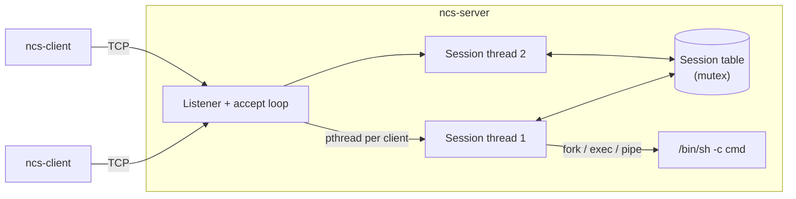

# Networked Concurrent Shell (NCS)

**A multi-client shell server in C.** Several people connect over TCP, each gets their own isolated shell session on the server, and they can message each other while they work.

Built as a team of four for a Systems Programming course. It combines three core systems topics in one codebase: **networking** (BSD sockets), **concurrency** (POSIX threads and a mutex-protected shared table) and **process control** (`fork`, `exec`, `pipe`, `waitpid`).

## Features

- **Up to 32 concurrent clients**, each served by its own detached POSIX thread
- **Isolated sessions:** every client has its own working directory, command history and nickname
- **Run any command:** non-built-ins run through `/bin/sh -c` in the session's directory; output streams back, followed by `[exit N]`
- **Built-ins:** `help`, `cd`, `pwd`, `whoami`, `history`, `sessions`, `echo`, `uptime`, `clear`, `exit`
- **Messaging between sessions:** `nick`, `who`, `msg <id> <text>`, `broadcast <text>`
- **Robust I/O:** `send_all()` handles short writes and `EINTR`; several commands in one `recv()` chunk are split correctly; quoted arguments are respected
- **Clean shutdown:** `Ctrl-C` / `SIGTERM` closes every session; `SIGPIPE` is ignored so a client that drops mid-write can't crash the server
- **Timestamped, thread-safe server log**

## Architecture



| Piece | What it does |
|---|---|
| Listener (`server.c`) | Opens the socket, accepts connections, registers each client in a fixed 32-slot session table under a mutex, and starts a detached thread for it |
| Session thread (`session.c`) | Reads lines from its client, keeps a 64-entry history ring buffer, and hands each command to the dispatcher |
| Dispatcher (`commands.c`) | Runs built-ins directly, or forks `/bin/sh -c` in the session's directory and pipes stdout/stderr back to the client |
| Messaging (`messaging.c`) | `nick` / `who` / `msg` / `broadcast`, reading other sessions through the shared table while holding the lock |
| Client (`client.c`) | One thread reads the socket and prints, the main thread sends what you type |

## Demo

Two clients connected at the same time. **alice:**
```text
ncs[1]:~$ nick alice
nick set to 'alice'
ncs[1]:~$ who
  [ 1] alice            ip=127.0.0.1  (you)
  [ 2] bob              ip=127.0.0.1
Connected: 2
ncs[1]:~$ msg 2 hi bob
(sent)
ncs[1]:~$ broadcast hello everyone
(delivered to 1)
ncs[1]:~$ cd src
ncs[1]:~/src$ ls *.c | wc -l
       6
[exit 0]
ncs[1]:~/src$ false
[exit 1]
```
**bob** sees the messages arrive inline:
```text
*** msg from [1 alice]: hi bob ***
*** broadcast from [1 alice]: hello everyone ***
```
Server log:
```text
[INFO] NCS server listening on 0.0.0.0:4242 (max clients=32)
[INFO] Client connected: id=1 ip=127.0.0.1 port=53846
[INFO] Client connected: id=2 ip=127.0.0.1 port=53845
[INFO] Shutting down, closing 32 possible sessions
[INFO] Server stopped cleanly
```

## Getting started

**Requirements:** `gcc` or `clang`, GNU `make`, and a POSIX system with pthreads (Linux, macOS or WSL).

```bash
make                          # builds bin/ncs-server and bin/ncs-client

./bin/ncs-server              # terminal 1: listens on port 4242 (or: ./bin/ncs-server 5050)
./bin/ncs-client 127.0.0.1    # terminal 2, 3, ...: connect (or: ./bin/ncs-client 127.0.0.1 5050)
```
Type `help` once connected, `exit` to disconnect, and `Ctrl-C` in the server terminal to shut everything down.

Built with `-Wall -Wextra -O2 -pthread`.

## Project layout

```text
src/
  server.c      listener, accept loop, session table, signal handling
  session.c     per-client thread loop, banner, prompt, history
  commands.c    dispatcher, built-ins, /bin/sh -c runner
  messaging.c   nick / who / msg / broadcast
  client.c      TCP client with a socket-reader thread
  utils.c       tokenizer, trim, send_all, logger
  *.h           shared constants, Session struct, declarations
docs/REPORT.txt full course report
```

## Team

| Member | Built |
|---|---|
| **Om Waikar** | Server core (`server.c`, `common.h`): TCP socket setup, accept loop, thread per client, mutex-protected session table, signal handling and clean shutdown, port parsing |
| Atharva Tupe | Sessions and commands (`session.c`, `commands.c`): session lifecycle, history, built-in dispatcher, `fork`/`exec` command runner |
| Samruddhi Navale | Client and utilities (`client.c`, `utils.c`, `Makefile`): TCP client, reader thread, quote-aware tokenizer, `send_all`, logger |
| Sakshi Takalkar | Messaging (`messaging.c`): `nick`, `who`, `msg`, `broadcast` with mutex-safe session access |
